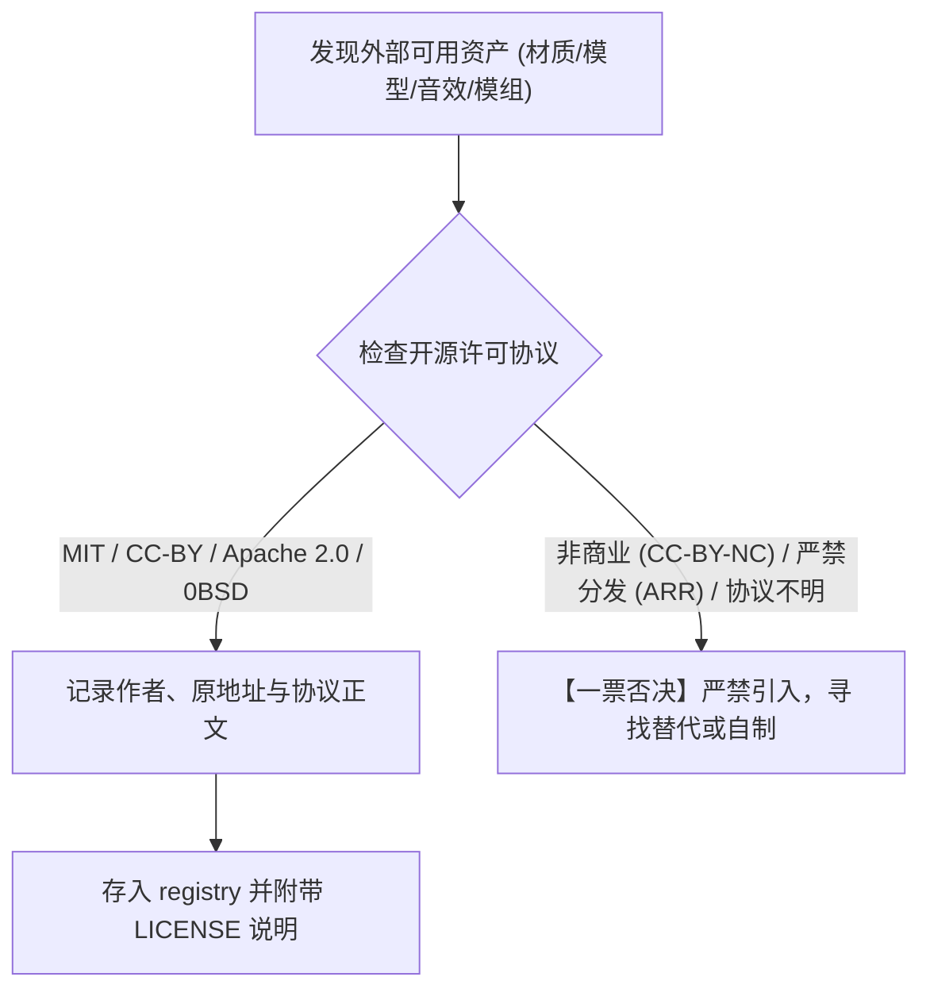

# 《Picking up hope again》外部资产引入许可登记册 (Asset Licensing Registry)

> **版本**：v1.0  
> **许可红线**：仅接受 **MIT**、**CC-BY** (Creative Commons Attribution) 或同等级完全允许修改与分发的宽松开源协议。严禁引入侵权、非商用或未授权资产。

---

## 1. 资产合规审核流程

---

## 2. 拟引入核心模组及许可登记清单

| 模组名称 | 用途说明 | 官方开源协议 | 来源与仓库链接 | 合规状态 |
| :--- | :--- | :--- | :--- | :--- |
| **Better Combat** | 核心动作手感、轻重连击与动作派生 | **MIT License** | [GitHub: daedelus-dev/better-combat](https://github.com/daedelus-dev/better-combat) | ✅ 已批准 |
| **Player Animator** | 玩家平滑骨骼动画驱动引擎 | **MIT License** | [GitHub: KosmX/minecraftPlayerAnimator](https://github.com/KosmX/minecraftPlayerAnimator) | ✅ 已批准 |
| **Curios API (Forge)** | 5格科技芯片（圣遗物）基础插槽框架 | **LGPL-3.0 / MIT** | [GitHub: TheIllusiveC4/Curios](https://github.com/TheIllusiveC4/Curios) | ✅ 已批准 |
| **Architectury API** | 多平台兼容与底层工具集 | **Architectury Open (MIT-like)** | [GitHub: architectury/architectury-api](https://github.com/architectury/architectury-api) | ✅ 已批准 |
| **Cloth Config** | 客户端/核心配置界面库 | **LGPL-3.0** | [GitHub: shedaniel/cloth-config](https://github.com/shedaniel/cloth-config) | ✅ 已批准 |

---

## 3. 音效与体素模型资产登记表

*(待引入时在此持续追加记录)*

| 资产编号 | 资产类型 | 资产名称 | 作者 / 来源网址 | 开源协议 | 用途说明 |
| :--- | :--- | :--- | :--- | :--- | :--- |
| `SND-001` | 音效 | Sci-Fi UI Click & Hum | Freesound (CC-BY 4.0) | CC-BY 4.0 | 传送锚点激活音效 |
| `MDL-001` | 体素模型 | High-Tech Wrench (重工扳手) | 自研原创 | MIT | 初始近战武器模型 |
